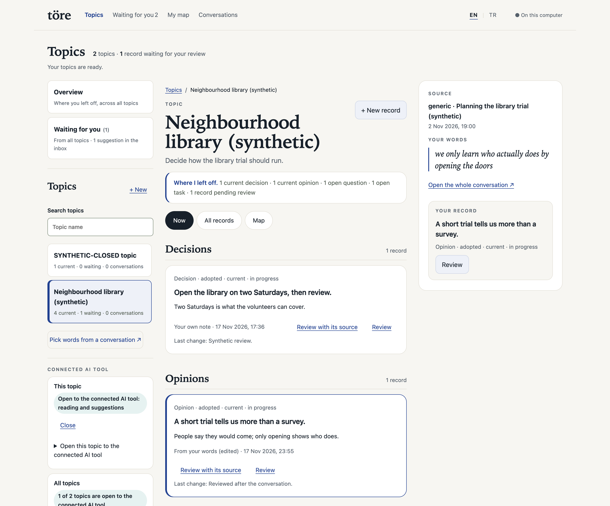

<h1 align="center">töre</h1>

<p align="center"><strong>A place where you can discuss the topics that interest you with people who share those interests.</strong></p>

<p align="center">
  Today, töre works as an open-source, local notebook. It keeps the decisions, views and open questions<br>
  from your conversations with AI together with their sources. The discussion app is in development.
</p>

<p align="center">
  <a href="https://ondersamet97.github.io/en/">Website</a> ·
  <a href="https://ondersamet97.github.io/">Türkçe</a> ·
  <a href="CHANGELOG.md">Change log</a> ·
  <a href="https://www.linkedin.com/company/tore-app/">LinkedIn</a>
</p>

<p align="center">
  
  
  
  
  
</p>

<p align="center">
  
</p>

> **Preview, not a finished product.** The interface is in English and Turkish, though some server-generated text, such as the thinker catalogue, is still Turkish only. It has been tested on macOS only. There is no installer: you build it from source, or run the macOS package described under Quick start, which is not notarized by Apple. Every screenshot here uses a synthetic example, not anyone's real notes.

## How it works

| | |
|---|---|
| **1. Bring your conversations** | Import conversations you already have from ChatGPT, Claude or Codex into a workspace on your own computer. |
| **2. Review what matters** | töre proposes source-linked candidates from your history: decisions, opinions and open questions. Nothing counts until you confirm it; you decide what to adopt, what to revise and what stays open. You can also pick a quote yourself. |
| **3. Continue with context** | When you return to a topic, choose the reviewed context to carry forward and paste it into the AI tool of your choice. Nothing goes anywhere unless you send it. |

<p align="center">
  
</p>

## What is in 0.19.0

### New in 0.19.0

- **The three voices as data.** A connected AI tool now receives each record of an opened topic or shared context with an explicit voice (your own word, an AI suggestion you did not adopt, a quoted source), its status and its origin: your own wording, or an AI suggestion you reviewed and kept. The structured form never says more than the text you opened. See [docs/MCP-STRUCTURED-OUTPUT.md](docs/MCP-STRUCTURED-OUTPUT.md).
- **A proposal must say what it rests on.** When a tool proposes a decision or objects to one of your positions, it has to give the exact text it relies on and where that text comes from; otherwise the proposal is refused. The inbox shows this basis as the tool's claim, and tells you whether a quote from one of your records is really in that record.
- **A macOS package that needs no build.** One binary for Apple Silicon and Intel, and an MCP bundle for AI tools that install such bundles. Not notarized by Apple; see Quick start.
- **Clearer answers to the tool.** A refused proposal says why, a folder without a notebook says so, and no message names a particular AI product.

### New in 0.18.0

- **töre opens on your map.** A large, branching map of your thoughts: My map, then the sections you think about, then your positions and what grew from them. Every thought and every thinker name is clickable. Two buttons below: **Look at my whole map** and **Look at my last thought** (the thought you discussed most recently).
- **Click a thought** to see why you adopted it with your exact words, the path it came from, and, folded away, the thoughts you went beyond to reach it.
- **Your own pasted writing counts.** When you paste a text you wrote yourself (a doctrine, notes, a draft), a report may propose thoughts from it, marked "from a text you pasted".
- The list map is still there under My map → List.

### New in 0.17.0

- **Update from your Claude Code conversations.** On the new **Update** page you open your Claude Code projects one by one (every project starts closed), pick conversations and ask for a report. Your own Claude Code reads one conversation at a time and proposes thoughts, each tied to an exact quote of your words; proposals whose quote does not match, or that carry passwords or keys, are dropped.
- **You decide every item.** Add to my map (adopted), Add as hypothesis, Don't add, or Later. Nothing enters your notebook by itself.
- **Surpassed thoughts.** When a new thought goes beyond an older one, and you say so, the older one is kept with its history and the new one takes its place on the map. The new **Surpassed thoughts** page lists thoughts gone beyond and the ones you chose not to add.
- **Lineage on the map.** Each thought shows when it was last discussed and, folded away, the thoughts that were gone beyond on the way to it.

### New in 0.16.0

- **A new design.** A calmer palette and type, the wordmark "töre", and a four-item menu: **Topics · Waiting for you · My map · Conversations**.
- **The topic desk.** Topics on the left, the topic in the centre (Now, All records, Map) and the selected record's source on the right. Each record carries one status line.
- **Waiting for you.** Records pending review and proposals from a connected AI tool in one list, each with its source. There is no accept-all; you decide one at a time.
- **First run and import receipt.** A new notebook shows three steps to begin, and every import ends with a receipt of what was read, what was skipped and what now waits for you.
- **English and Turkish.** Switch with EN | TR in the top bar; töre remembers the choice beside your notebook. English is the default unless your browser is set to Turkish.

### New in 0.15.0

- **Claude Code plugin.** Install [töre for Claude Code](https://github.com/ondersamet97/tore-claude-plugin) and say "continue from my töre topic X": Claude reads that topic's adopted decisions, open tasks and open questions, and `/tore:propose` leaves a result in your inbox. The plugin contains no data; it connects to the töre on your own computer.
- **Trash.** Move any record to the trash, restore it, or delete it permanently with a separate consent and an automatic backup first.
- **Open every topic at once.** One consent on **Topics** opens all existing topics to the connected AI tool; one click closes them all.
- **A connector that survives updates.** An older connector skips records written in a newer format instead of failing, and asks you to reconnect when it cannot read the notebook.
- **A clean start.** The demo launcher is gone. `Başlat.command` starts a new checkout with an empty notebook.

### Topics: return to unfinished thinking

- Custom topics with a **Where I left off** view: current decisions, opinions, open questions and what still awaits review.
- Review, adoption, currency and work priority are separate states. An open question cannot silently become an adopted belief; closing it takes an explicit action and a reason.
- Every revision keeps its previous wording and the reason for the change.
- A global overview and one **Waiting for you** list across all topics.

### Map of my thinking: let a reader see where you stand

A reader-facing page (**My map**, `/harita`) that arranges records you already have into nine sections, from starting points to how a person and a society should live. Each record takes a role: premise, position, divergence, change of view, objection, answer, what would refute it, or open question.

- **Test a view.** Under any position you can write an objection, your answer to it and the evidence that would change your mind. The page shows, per position, how many objections it has, how many are answered and whether a refutation criterion is stated.
- **Nothing is inferred.** The map only places records. Each one keeps its own source quote, review and adoption state, and a record awaiting review is shown as such, never as your view. A placement proposed by an assistant is marked until you confirm it.
- **Turkish and English.** A translation is stored next to the entry and labelled as an AI translation or as your own; the original wording always stays visible.
- **One file to hand over.** With explicit consent töre writes a single script-free HTML file to your computer. By default it contains only records you reviewed and did not reject; conversation titles and identifiers are left out. töre sends it nowhere.

### Work with Claude Code from töre

- **Tasks.** Besides decisions, opinions and questions, a topic now holds tasks. A task is open or closed; only you close it.
- **Open a topic to a connected AI tool.** `tore-server mcp --data <folder>` lets Claude Code read the topics you opened: your adopted decisions and opinions, open tasks and open questions, nothing else.
- **Proposals wait for you.** If you allow it for a topic, the tool can leave a proposal: a task result, a decision, a question, a new task or an objection to one of your positions. It waits in the inbox under **Waiting for you**; the tool never writes your notebook, and an accepted proposal stays an unreviewed AI proposal until you review it. See [docs/MCP.md](docs/MCP.md).
- **Import Claude Code sessions** kept on this computer, only when you ask, through the usual preview.

### Thinkers: place your notes next to the thinkers you read

An editorial catalogue of eight thinkers (Gökalp, Hegel, Ibn Khaldun, Gellner, Weber, Hobbes, Fichte, Schmitt) with their works, ideas, criticisms and stated limits. You link your own records to a thinker yourself, with an optional note.

töre does not score your affinity, rank you or infer an identity. Linking and unlinking both need your explicit confirmation.

<p align="center">
  
</p>

### Connected AI tool: no copy-paste

Instead of copying a prepared context, you can open that one text to an AI tool on the same computer that speaks the Model Context Protocol, such as Claude Desktop or Claude Code. Opening it takes its own confirmation, the page shows **Open to the connected AI tool** while it is open, and one click closes it again. The tool can read only the contexts you opened, never your records, conversations or anything else, and it cannot write to töre. See [docs/MCP.md](docs/MCP.md).

## Principles

- **Three voices stay distinct.** The original quote, your own words and the AI's interpretation are kept apart and labelled.
- **Nothing becomes your view silently.** Silence is not consent. An AI suggestion starts unadopted and stays labelled as AI material.
- **Local by default.** The server binds to loopback on your own computer. Organising topics and linking thinkers call no language model and no paid service.
- **It does not compete for your attention.** No notifications, no streaks, no infinite feed.

## Quick start

Requirements: Rust with edition 2024 support, Python 3 and Node.js 22.12 or newer (Node 26 or newer for the full test suite). The launchers are for macOS; other platforms have not been verified. Installing dependencies uses the network; it does not upload application data.

```sh
cd local-reader
npm ci --ignore-scripts
cd ..
bash scripts/build.sh
bash Başlat.command
```

`Başlat.command` is the everyday launcher. It keeps your data in `.demo-data` inside the checkout; despite the name, treat that folder as your real notebook and back it up.

The launcher opens a loopback URL that carries a local access token. Keep that URL private. Closing the browser tab does not stop the server; use the application's shutdown control or Ctrl-C in its terminal.

### Without building (macOS)

`scripts/package-macos.sh` produces two files that need no Rust, Node.js or Python on the computer that runs them: `tore-server`, one binary for Apple Silicon and Intel with the interface inside it, and `tore-mcp-darwin.mcpb`, an MCP bundle with the same binary. When a release carries them, they are on the [releases page](https://github.com/ondersamet97/tore/releases).

```sh
chmod +x tore-server
mkdir -p "$HOME/tore/archive" "$HOME/tore/data"
./tore-server --archive "$HOME/tore/archive" --data "$HOME/tore/data" --open
```

Both folders must be absolute paths without symbolic links. `--data` is your notebook: back it up. An AI tool that installs MCP bundles asks for the same data folder when you open the `.mcpb` file; any other MCP client can run `tore-server mcp --data <folder>` as described in [docs/MCP.md](docs/MCP.md).

The package is signed ad hoc only. It is not signed with a developer identity and not notarized by Apple, so macOS will refuse to open a downloaded copy until you allow it yourself under System Settings → Privacy & Security. It has been tried on macOS only, and not yet by anyone outside the project. If you would rather not run a binary you did not build, build from source as above.

Run the tests:

```sh
cargo test --locked --manifest-path core/Cargo.toml
cargo test --locked --manifest-path server/Cargo.toml
node --test local-reader/tests/*.test.cjs
```

## Data and privacy

- Private operations are protected by a session token and Host/Origin checks.
- Copying context to the clipboard is a separate, deliberate action. The destination service receives the text only if you paste and send it there; clipboard history and the destination's retention are outside töre's control.
- Optional connections to AI services exist but are experimental and are not needed for anything described above.
- töre has no tool that packages your conversations or notes as a dataset for research or model training.
- This repository contains source code and synthetic fixtures only. It contains no personal notebook, conversation or credential.

## Limitations

töre is a single-user preview. There is no multi-user isolation, cloud sync, hosted service or availability guarantee. Records are statements you reviewed, not verified truths. See [known limitations](docs/PREVIEW-LIMITATIONS.md).

## Documentation

| | |
|---|---|
| [Architecture and data flow](docs/PREVIEW-ARCHITECTURE.md) | How the local server, stores and pages fit together |
| [Record and API contract](docs/RECORDS-CONTRACT.md) | Record states, operations and storage rules |
| [Connected AI tool (MCP)](docs/MCP.md) | Opening one prepared context to Claude Desktop or Claude Code, read-only |
| [Known limitations](docs/PREVIEW-LIMITATIONS.md) | What this preview does not do |
| [Claude Code plugin](https://github.com/ondersamet97/tore-claude-plugin) | Continue from a topic and leave proposals from Claude Code |
| [0.16.0 release note](docs/RELEASE-0.16.0.md) | What changed and how it was checked |
| [Third-party notices](docs/THIRD-PARTY-NOTICES.md) | Licences of bundled and linked components |

## Releases

This repository is updated once per release. Every release and what changed in it are listed in the [change log](CHANGELOG.md).

## Licence

**Open source, with a commercial option.** töre is free software under the [GNU Affero General Public License v3](LICENSE) (AGPL-3.0-only). You may use, study, modify and share it; if you distribute it or run a modified version as a network service, you must offer your source under the same licence.

If those terms do not work for you, for example because you want to build töre into a closed product, a separate [commercial licence](COMMERCIAL-LICENSE.md) is available from the owner.

Third-party code keeps its own licences in `licenses/`, `vendor/` and `local-reader/vendor/`. Your conversations and notes are yours and are not covered by the software licence. Copyright notice and licence history: [NOTICE.md](NOTICE.md).

## Contact

töre is an independent open-source project. For questions, bug reports or a commercial-licence enquiry, write to [töre on LinkedIn](https://www.linkedin.com/company/tore-app/) or use the email address on the [contact page](https://ondersamet97.github.io/kim.html).
