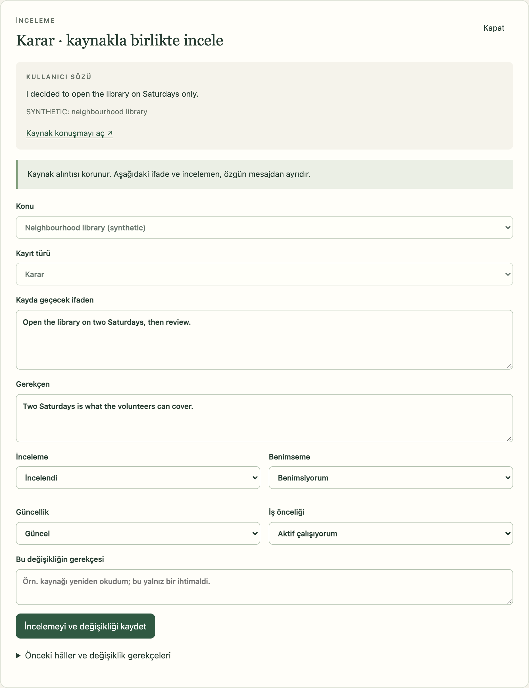
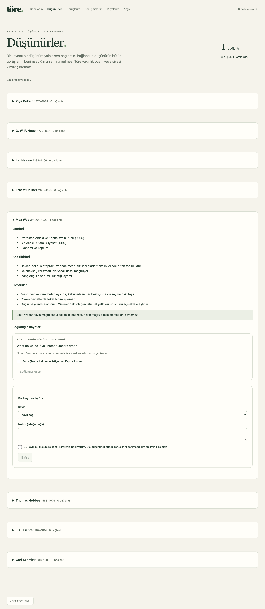
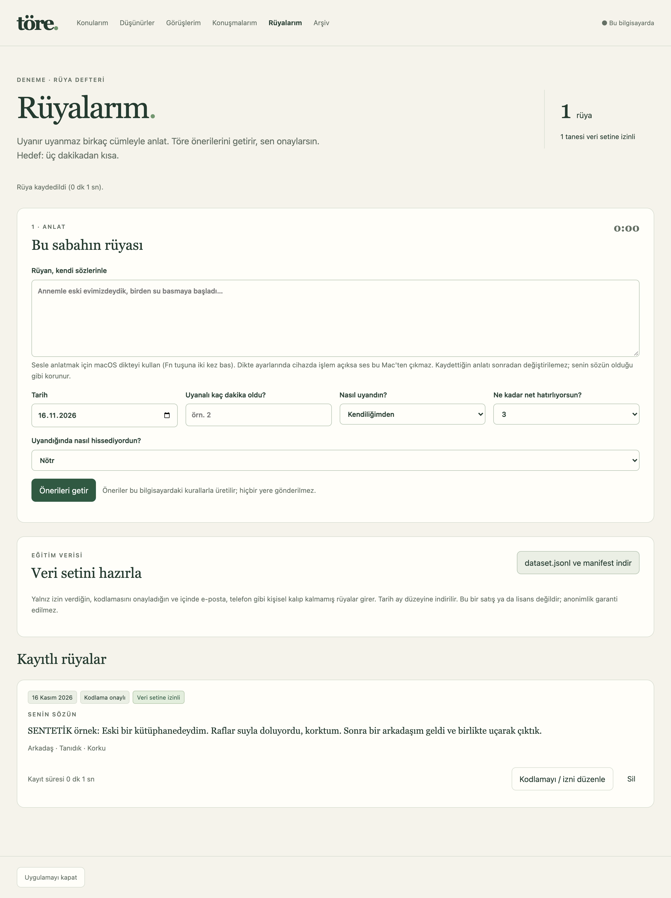

<h1 align="center">töre</h1>

<p align="center"><strong>Pick up your thinking where you left off.</strong></p>

<p align="center">
  A local notebook that keeps the ideas, decisions and open questions from your AI conversations<br>
  connected to their sources, so you can return to a topic and continue with the right context.
</p>

<p align="center">
  <a href="https://ondersamet97.github.io/tore-site/">Website</a> ·
  <a href="https://ondersamet97.github.io/tore-site/tr/">Türkçe</a> ·
  <a href="docs/PREVIEW-DEMO.md">Three-minute demo</a> ·
  <a href="ABOUT.md">About me</a> ·
  <a href="CHANGELOG.md">Change log</a> ·
  <a href="https://www.linkedin.com/company/tore-app/">LinkedIn</a>
</p>

<p align="center">
  
  
  
  
  
</p>

<p align="center">
  
</p>

> **Preview, not a finished product.** The interface is Turkish for now, it has been tested on macOS only, and there is no installer: you build it from source. Every screenshot here uses a synthetic example, not anyone's real notes.

## The question

Long conversations with AI tools produce decisions, reasons and open questions, and then they scroll away. Weeks later it is hard to say what you decided, why, what changed and what is still open.

töre is built around one question: **where did I leave off?**

## How it works

| | |
|---|---|
| **1. Bring your conversations** | Import conversations you already have from ChatGPT, Claude or Codex into a workspace on your own computer. |
| **2. Review what matters** | Pick a quote and turn it into a source-linked decision, opinion or open question. You decide what to adopt, what to revise and what stays open. |
| **3. Continue with context** | When you return to a topic, choose the reviewed context to carry forward and paste it into the AI tool of your choice. Nothing goes anywhere unless you send it. |

<p align="center">
  
</p>

## What is in 0.12.0

### Topics: return to unfinished thinking

- Custom topics with a **Kaldığım yer** ("where I left off") view: current decisions, opinions, open questions and what still awaits review.
- Review, adoption, currency and work priority are separate states. An open question cannot silently become an adopted belief; closing it takes an explicit action and a reason.
- Every revision keeps its previous wording and the reason for the change.
- A global overview and a review queue across all topics.

### Thinkers: place your notes next to the thinkers you read *(new)*

An editorial catalogue of eight thinkers (Gökalp, Hegel, Ibn Khaldun, Gellner, Weber, Hobbes, Fichte, Schmitt) with their works, ideas, criticisms and stated limits. You link your own records to a thinker yourself, with an optional note.

töre does not score your affinity, rank you or infer an identity. Linking and unlinking both need your explicit confirmation.

<p align="center">
  
</p>

### Dreams: write down a dream in under three minutes *(experimental)*

Record a morning dream in your own words. Offline rules suggest codes for characters, emotions, settings and themes; you confirm them, and your original account stays unchanged. A timer shows how long the entry took.

You can consent, dream by dream, to include one in a dataset file for AI training. You create that file yourself. Only consented, confirmed dreams with no remaining known personal-data patterns go in, with month-level dates. Nothing is sold or sent, and anonymity is not guaranteed.

<p align="center">
  
</p>

## Principles

- **Three voices stay distinct.** The original quote, your own words and the AI's interpretation are kept apart and labelled.
- **Nothing becomes your view silently.** Silence is not consent. An AI suggestion starts unadopted and stays labelled as AI material.
- **Local by default.** The server binds to loopback on your own computer. Organising topics, linking thinkers and coding dreams call no language model and no paid service.
- **It does not compete for your attention.** No notifications, no streaks, no infinite feed.

## Quick start

Requirements: Rust with edition 2024 support, Python 3 and Node.js 22.12 or newer (Node 26 or newer for the full test suite). The launchers are for macOS; other platforms have not been verified. Installing dependencies uses the network; it does not upload application data.

```sh
cd local-reader
npm ci --ignore-scripts
cd ..
bash scripts/build.sh
bash Preview.command
```

`Preview.command` opens an isolated store in `.preview-data`, so you can try töre without touching any other data. Import `fixtures/return-topic.json` under **Konuşmalarım** and follow [the three-minute demo](docs/PREVIEW-DEMO.md).

`Başlat.command` is the everyday launcher. It keeps your data in `.demo-data` inside the checkout; despite the name, treat that folder as your real notebook and back it up.

The launcher opens a loopback URL that carries a local access token. Keep that URL private. Closing the browser tab does not stop the server; use the application's shutdown control or Ctrl-C in its terminal.

Run the tests:

```sh
cargo test --locked --manifest-path core/Cargo.toml
cargo test --locked --manifest-path server/Cargo.toml
node --test local-reader/tests/*.test.cjs
```

## Data and privacy

- Private operations are protected by a session token and Host/Origin checks.
- Copying context to the clipboard is a separate, deliberate action. The destination service receives the text only if you paste and send it there; clipboard history and the destination's retention are outside töre's control.
- Optional connections to AI services exist but are experimental and are not needed for anything described above.
- Dream dictation uses macOS's own dictation; töre does not record or upload audio.
- This repository contains source code and synthetic fixtures only. It contains no personal notebook, conversation or credential.

## Limitations

töre is a single-user preview. There is no multi-user isolation, cloud sync, hosted service or availability guarantee. Records are statements you reviewed, not verified truths. Rule-based dream codes are suggestions, not analysis. See [known limitations](docs/PREVIEW-LIMITATIONS.md).

## Documentation

| | |
|---|---|
| [Architecture and data flow](docs/PREVIEW-ARCHITECTURE.md) | How the local server, stores and pages fit together |
| [Record and API contract](docs/RECORDS-CONTRACT.md) | Record states, operations and storage rules |
| [Demo script](docs/PREVIEW-DEMO.md) | A synthetic walk-through in two to three minutes |
| [Known limitations](docs/PREVIEW-LIMITATIONS.md) | What this preview does not do |
| [0.12.0 release note](docs/RELEASE-0.12.0.md) | What changed and how it was checked |
| [Third-party notices](docs/THIRD-PARTY-NOTICES.md) | Licences of bundled and linked components |

## Releases

This repository is updated release by release, starting with 0.12.0. Day-to-day development happens in a private working repository, and earlier versions were not published.

## Licence

**Source-available, noncommercial.** The original code is offered under the [PolyForm Noncommercial License 1.0.0](LICENSE); the required copyright notice is in [NOTICE.md](NOTICE.md). You may read, run and modify it for noncommercial purposes. Commercial use needs the owner's separate written permission. This is not an open-source licence.

Third-party code keeps its own licences in `licenses/`, `vendor/` and `local-reader/vendor/`. Your conversations, notes and exported datasets are yours and are not covered by the software licence.

## About me

töre is an independent project by Önder Samet. Who I am, why I am building töre and what I hold to are in **[About me](ABOUT.md)**.

Questions and commercial-use requests: [töre on LinkedIn](https://www.linkedin.com/company/tore-app/).
